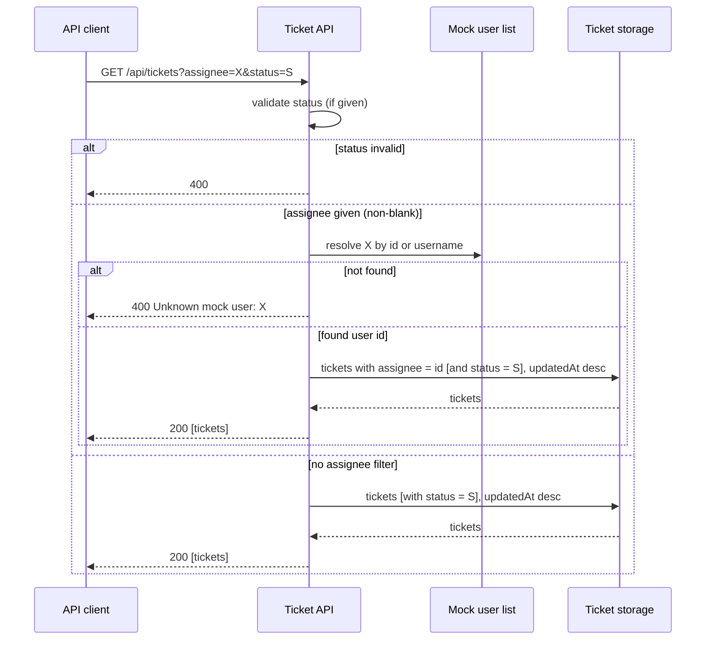

# Ticket list filter by assignee
Spec: Ticket list filter by assignee · Status: ready-for-planning · Date: 2026-10-15
Areas: api
Design sources: text request; backend code under `backend/src` (ticket controller, ticket and mock user services, exception handler, config, integration tests); `docs/api.md`, `docs/project-tasks.md`, `docs/testing.md`; `frontend/src/api/ticketApi.ts` (consumer). No design frames. Paths below are relative to `backend/src/main/java/com/tasktracker/` unless they start with `backend/`, `docs/` or `frontend/`.
Related: none (no earlier specs exist; this extends backlog items TT-006 and TT-007 in `docs/project-tasks.md`)

## 1. Goal
Clients of the ticket list endpoint can only narrow the list by status today, so finding "the tickets of a given person" requires fetching everything and filtering client-side. This feature lets an API client ask for the tickets assigned to one mock user, identified by mock user id or by username exactly as the assignment endpoint accepts them, optionally combined with the existing status filter. It is a backend-only change; the web UI is not touched.

## 2. Context
- `GET /api/tickets` accepts one optional query parameter `status` (a `TicketStatus` value) and returns a JSON array of tickets ordered by `updatedAt` descending (`TicketController.java:44-47`, `TicketService.java:34-39`, `TicketRepository.java:14-16`, `docs/api.md:56-63`). There is no pagination or other sorting option.
- Assignment `PATCH /api/tickets/{id}/assignee` takes `{ "assignee": "<id or username>" }` (`docs/api.md:73-88`). The value is resolved against the mock user list: trimmed, matched case-insensitively against either the user `id` or the `username`, first match in list order wins (`MockUserService.java:23-31`).
- An unknown mock user on assignment yields `400 Bad Request`, RFC 7807 problem details with `detail` = `Unknown mock user: <value>` (`TicketService.java:48-49`, `GlobalExceptionHandler.java:25-28`, `docs/api.md:125`). The user is resolved before the ticket is looked up, so an unknown user wins over an unknown ticket (`TicketService.java:48-50`).
- A ticket stores the resolved mock user **id** (for example `u-001`), never the username; the list response exposes it as field `assignee`, `null` when unassigned (`TicketService.java:51`, `TicketResponse.java:14,24`, `Ticket.java:33-34`).
- Mock users come from configuration: `u-001 alice`, `u-002 bob`, `u-003 carol`, `u-004 dan`, `u-005 eve` (`application.yml:41-56`); the integration-test profile defines only `u-001 alice` and `u-002 bob` (`application-it.yml:13-19`). They are exposed via `GET /api/users` (`docs/api.md:103-109`).
- An invalid `status` value is not handled by the project's own exception handler (`GlobalExceptionHandler.java:15-41` has no handler for query-parameter conversion errors); it falls back to the framework's default `400` response.
- The only list consumer in the repo, the web client, sends `status` only (`frontend/src/api/ticketApi.ts:10-15`).
- Existing list tests: ordering and status filter (`TicketApiIT.java:69-80`, `167-176`).

## 3. Scope
### In scope
- A new optional query parameter `assignee` on `GET /api/tickets`.
- Resolution of the parameter value with the same rules as ticket assignment.
- Combination of `assignee` and `status` as a logical AND.
- Error behaviour for an unknown mock user in the filter.
- API reference documentation (`docs/api.md` and the OpenAPI description) for the new parameter.

### Out of scope
- No file under `frontend/` is changed by this feature.
- No filter for unassigned tickets is provided (no sentinel value such as `none` is recognised).
- No multi-value assignee filter: a request cannot select tickets of more than one user.
- No pagination, page size or new sort option is added to `GET /api/tickets`.
- The manager endpoint `GET /api/manager/tickets/done-candidates` does not gain an assignee filter.
- The response body schema of `GET /api/tickets` (ticket fields) is unchanged.
- No change to how `PATCH /api/tickets/{id}/assignee` resolves or rejects users.
- No persisted data or schema change is made.

## 4. User scenarios
- US1 — As an API client, I list the tickets assigned to one mock user by giving their id or username, so that I see that person's work without client-side filtering.
- US2 — As an API client, I combine the assignee filter with the status filter, so that I see, for example, what one person has in progress.
- US3 — As an API client, I get a clear error when I filter by a user that does not exist, so that a typo is not mistaken for "this person has no tickets".

## 5. Functional requirements
- FR1 [api] — `GET /api/tickets` shall accept an optional query parameter `assignee` whose value is a mock user id or username. (US1)
- FR2 [api] — The `assignee` value shall be resolved to a mock user with the same rules as ticket assignment: leading/trailing whitespace ignored, case-insensitive match against user id or username, first match in mock user list order. (US1)
- FR3 [api] — When `assignee` resolves to a mock user, the response shall contain exactly the tickets whose current assignee is that user, and no others. (US1)
- FR4 [api] — When both `assignee` and `status` are given, the response shall contain exactly the tickets that match both filters. (US2)
- FR5 [api] — When `assignee` does not resolve to any mock user, the request shall fail with `400 Bad Request`, problem details, `detail` = `Unknown mock user: <value>`, where `<value>` is the parameter value as received. (US3)
- FR6 [api] — When `assignee` is absent, empty or whitespace only, no assignee filter shall be applied and the endpoint shall behave exactly as before this feature. (US1)
- FR7 [api] — Filtered results shall keep the existing ordering: `updatedAt` descending. (US1, US2)
- FR8 [api] — The API reference (`docs/api.md`) and the OpenAPI description served at `/v3/api-docs` shall document the `assignee` parameter, its accepted values and the `400` unknown-user error. (US1, US3)

## 6. Workflow and communication
Single synchronous HTTP request; the only collaborator is the in-memory mock user list (configuration), then ticket storage. Validation happens before any ticket is read.

- Client → Ticket API: synchronous; on `400` the client must correct the request; no retry semantics (read-only, idempotent).
- Ticket API → mock user list: in-process, synchronous; cannot fail other than "not found" (handled as `400`).
- Ticket API → ticket storage: synchronous; a storage failure produces the same server error the unfiltered list produces today (no new handling).

## 7. Contracts
`GET /api/tickets` (changed, backwards compatible)

| Query parameter | Type | Required | Meaning |
|---|---|---|---|
| `status` | enum `TODO` \| `IN_PROGRESS` \| `DONE_CANDIDATE` \| `DONE` | no | Existing. Only tickets in this status. |
| `assignee` | string (mock user id, e.g. `u-001`, or username, e.g. `alice`) | no | New. Only tickets currently assigned to this mock user. Trimmed, case-insensitive. Empty or whitespace-only = no filter. |

Both parameters given → AND.

Responses:
- `200 OK` — `application/json`, array of ticket objects (unchanged schema: `id` uuid, `title` string, `description` string\|null, `status` enum, `assignee` string\|null = mock user id, `createdAt` and `updatedAt` ISO-8601 instants), ordered by `updatedAt` descending. An empty array when nothing matches.
- `400 Bad Request` — `application/problem+json`, `status` = 400, `detail` = `Unknown mock user: <value>` when `assignee` does not resolve.
- `400 Bad Request` — invalid `status` value (existing behaviour, unchanged; takes precedence over an unknown `assignee`).

Limits: one `assignee` value per request. No pagination.
Consumers: `frontend/src/api/ticketApi.ts` (sends `status` only; unaffected).

## 8. Data model (logical)
n/a — no entity changes. The filter uses the existing ticket attribute "assignee" (a mock user id, or none); mock users remain configuration-only.

## 9. States and UX
n/a — backend only; no screen or UI element changes.

## 10. Edge cases
- EC1 [api] — `assignee` given by username in a different case or with surrounding spaces (e.g. ` ALICE `) → resolves to that user, same result as `alice`. (FR2)
- EC2 [api] — `assignee` given by id (`u-001`) and by username (`alice`) of the same user → identical responses. (FR2, FR3)
- EC3 [api] — Known mock user with no assigned tickets → `200` with `[]`. (FR3)
- EC4 [api] — Known user, `status` given, user has tickets but none in that status → `200` with `[]`. (FR4)
- EC5 [api] — `assignee` value that is not a known user (e.g. `ghost`, or `carol` in an environment whose mock list lacks carol) → `400 Unknown mock user: ghost`. (FR5)
- EC6 [api] — `assignee` present but empty (`?assignee=`) or whitespace only → no assignee filter applied, same result as omitting it. (FR6)
- EC7 [api] — Invalid `status` and unknown `assignee` in the same request → `400` from the status validation (existing behaviour); the unknown user is not reported. (FR5)
- EC8 [api] — Ticket reassigned from user A to user B → appears under `assignee=B` and no longer under `assignee=A`. (FR3)
- EC9 [api] — Unassigned tickets → never returned when an assignee filter is applied. (FR3)
- EC10 [api] — `assignee` parameter repeated (`?assignee=alice&assignee=bob`) → not a supported multi-value filter; the request shall not return tickets of both users; it fails with `400`. (FR5)

## 11. Non-functional requirements
- NFR1 [api] — Backwards compatibility: every request that does not include a non-blank `assignee` shall return the same status code and body as before this feature (existing list tests keep passing unchanged).
- NFR2 [api] — Security: the echoed `<value>` in the unknown-user error is returned only inside the JSON problem-details body (`application/problem+json`), never as raw HTML or in a response header.

## 12. Dependencies and rollout
- Shared-contract change: yes — `GET /api/tickets` gains an optional query parameter; additive and backwards compatible; the only in-repo consumer (web client) is unaffected.
- Persisted data change: no.
- Feature flag: none.
- Release order: none; single area.

## 13. Acceptance criteria
Setup for ACs unless stated otherwise: mock users `u-001 alice` and `u-002 bob` exist (integration profile); tickets T1 and T2 assigned to alice, T3 assigned to bob, T4 unassigned.

- AC1 [api] — Given the setup, when `GET /api/tickets?assignee=alice`, then `200` with exactly T1 and T2.
  Traces: FR1, FR3, EC9 · Verify: integration
- AC2 [api] — Given the setup, when `GET /api/tickets?assignee=u-001`, then `200` with exactly T1 and T2 (same set as AC1).
  Traces: FR2, EC2 · Verify: integration
- AC3 [api] — Given the setup, when `GET /api/tickets?assignee=%20ALICE%20`, then `200` with exactly T1 and T2.
  Traces: FR2, EC1 · Verify: integration
- AC4 [api] — Given the setup with T1 in `IN_PROGRESS` and T2 in `TODO`, when `GET /api/tickets?assignee=alice&status=IN_PROGRESS`, then `200` with exactly T1.
  Traces: FR4 · Verify: integration
- AC5 [api] — Given the setup with all of bob's tickets in `TODO`, when `GET /api/tickets?assignee=bob&status=DONE_CANDIDATE`, then `200` with `[]`.
  Traces: FR4, EC4 · Verify: integration
- AC6 [api] — Given the setup, when `GET /api/tickets?assignee=ghost`, then `400`, content type `application/problem+json`, `detail` = `Unknown mock user: ghost`.
  Traces: FR5, EC5, NFR2 · Verify: integration
- AC7 [api] — Given the setup, when `GET /api/tickets?assignee=` and when `GET /api/tickets?assignee=%20%20`, then each returns `200` with T1–T4, identical to `GET /api/tickets`.
  Traces: FR6, EC6 · Verify: integration
- AC8 [api] — Given T1 updated after T2, when `GET /api/tickets?assignee=alice`, then `$[0]` is T1 and `$[1]` is T2.
  Traces: FR7 · Verify: integration
- AC9 [api] — Given a known mock user with no tickets assigned (bob, with T3 reassigned to alice), when `GET /api/tickets?assignee=bob`, then `200` with `[]`.
  Traces: FR3, EC3 · Verify: integration
- AC10 [api] — Given T3 reassigned from bob to alice, when `GET /api/tickets?assignee=alice` and `GET /api/tickets?assignee=bob`, then T3 is in the first response and not in the second.
  Traces: FR3, EC8 · Verify: integration
- AC11 [api] — Given the setup, when `GET /api/tickets?status=NOT_A_STATUS&assignee=ghost`, then `400` and the response `detail`, if present, does not contain `Unknown mock user`.
  Traces: EC7 · Verify: integration
- AC12 [api] — Given the setup, when `GET /api/tickets?assignee=alice&assignee=bob`, then `400`.
  Traces: EC10 · Verify: integration
- AC13 [api] — Given the existing list tests (ordering, status filter) unchanged, when the backend test suite runs, then they pass, and `GET /api/tickets?status=TODO` without `assignee` returns the same tickets as before the change.
  Traces: NFR1, FR6 · Verify: integration
- AC14 [api] — Given the running backend, when `GET /v3/api-docs` is fetched, then the `GET /api/tickets` operation lists an optional query parameter `assignee` of type string; and `docs/api.md` "List tickets" shows an `assignee` example and the `400` unknown-user case.
  Traces: FR8 · Verify: manual

## 14. Traceability
| Source (request / design frame / US) | Area | FR | EC / NFR | AC |
|---|---|---|---|---|
| Request: filter by assignee (id or username), US1 | api | FR1, FR2, FR3 | EC1, EC2, EC3, EC8, EC9 | AC1, AC2, AC3, AC9, AC10 |
| Request: combine with status, US2 | api | FR4 | EC4, EC7 | AC4, AC5, AC11 |
| Request: unknown users handled sensibly, US3 | api | FR5 | EC5, EC10, NFR2 | AC6, AC12 |
| Gap: blank parameter | api | FR6 | EC6, NFR1 | AC7, AC13 |
| Existing contract: ordering | api | FR7 | — | AC8 |
| Docs convention (`docs/api.md`, Swagger) | api | FR8 | — | AC14 |

## 15. Design review
| # | Gap / proposal | Source | Area | Decision (accepted / rejected / open) |
|---|---|---|---|---|
| 1 | Unknown user: error vs empty list | request | api | accepted — 400 (D2) |
| 2 | Filter for unassigned tickets | gap | api | rejected — out of scope (D4) |
| 3 | Blank `assignee` value | gap | api | accepted — no filter (D3) |
| 4 | Invalid status vs unknown user precedence | gap | api | accepted — status error first (D5) |
| 5 | Repeated / multi-value parameter | gap | api | accepted — 400 (D6) |
| 6 | Invalid `status` body is framework default, not project problem details | `GlobalExceptionHandler.java:15-41` | api | rejected — unchanged (D7) |
| 7 | Pagination for filtered lists | gap | api | rejected — out of scope (D8) |

## 16. Decisions
All decisions below were former open questions Q1–Q10; the user accepted every default as written (user, relayed by the coordinating agent, 2026-10-15).

- D1 — Query parameter name? (Q1) → `assignee`, matching the assignment request field and the `assignee` field of the ticket response (`AssignTicketRequest.java`, `TicketResponse.java:14`). (user, 2026-10-15)
- D2 — Unknown user: `400` error or `200 []`? (Q2) → `400`, `detail` = `Unknown mock user: <value>`, consistent with assignment (`TicketService.java:48-49`, `docs/api.md:125`) and so typos are distinguishable from "no tickets". (user, 2026-10-15)
- D3 — Empty or whitespace-only `assignee`: ignore or reject? (Q3) → ignore (no filter), mirroring how an empty `status` is treated as absent by request binding and keeping lenient query semantics; assignment's `@NotBlank` applies to a required body field, not an optional filter. (user, 2026-10-15)
- D4 — Should there be a way to list unassigned tickets (e.g. `assignee=none`)? (Q4) → no, out of scope; a sentinel could collide with a username and was not requested. (user, 2026-10-15)
- D5 — Invalid `status` together with unknown `assignee`: which error is reported? (Q5) → the status error (existing behaviour, request binding happens first); both are `400`, so only the `detail` differs. (user, 2026-10-15)
- D6 — Repeated `assignee` parameter? (Q6) → unsupported, `400`; multi-user filtering was not requested. (user, 2026-10-15)
- D7 — Should invalid `status` now also return project-style problem details? (Q7) → no, unchanged; out of this feature's scope. (user, 2026-10-15)
- D8 — Pagination or a size limit for filtered results? (Q8) → none, consistent with the current unpaginated list (`TicketRepository.java:14-16`). (user, 2026-10-15)
- D9 — Matching semantics: id and username both case-insensitive and trimmed? (Q9) → yes, reuse assignment resolution unchanged (`MockUserService.java:23-31`) so the filter accepts exactly what assignment accepts. (user, 2026-10-15)
- D10 — Performance budget for the filtered list? (Q10) → none beyond the existing list endpoint; note there is no storage index on the assignee attribute today (`backend/src/main/resources/db/migration/V1__create_tickets.sql:12-13`), which the planner may weigh. (user, 2026-10-15)

## 17. Open questions
- none — Q1–Q10 were resolved on 2026-10-15 and are recorded as D1–D10 in section 16.
